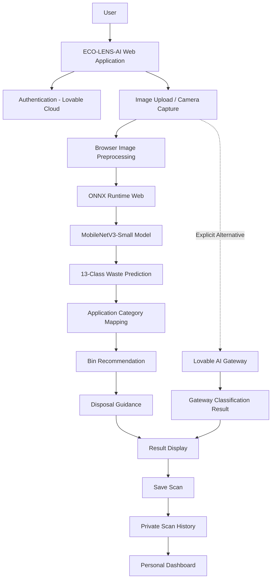

# ECO-LENS-AI — AI-Powered Smart Waste Segregation System

**Scan. Sort. Save.**

Neural Storm 2026 · Track: Green Planet · Problem Statement GP-05: Smart Waste Segregation System

| Project Details | Information |
|---|---|
| Team Name | solo stack |
| Team Leader | Jashika R |
| Institution | Rathinam Technical Campus |
| GitHub Repository | [eco-lens-waste](https://github.com/jashikaraja05-pixel/eco-lens-waste) |
| Live Application | [ECO-LENS-AI](https://eco-lens-waste.lovable.app) |
| Demo Video | [Watch ECO-LENS-AI Demo](https://drive.google.com/file/d/1YGdSYP2cZFC_ar5uKUi2GesWO0AZiHfv/view?usp=sharing) |

**Scan. Sort. Save. — Making responsible waste segregation easier with AI.**

---

## 1. Problem Statement

Incorrect waste segregation causes environmental pollution and reduces recycling efficiency. Mixed household waste spoils recycling streams and sends hazardous items such as batteries and electronic waste to landfills.

Many people do not know which waste bin an item belongs in. Traditional printed segregation guides are also difficult to remember and follow consistently.

An intelligent, accessible, and easy-to-use waste identification system can help people make better waste disposal decisions and promote responsible waste management.

## 2. Proposed Solution

ECO-LENS-AI is an AI-powered smart waste segregation application that helps users identify and dispose of waste responsibly.

Users can upload an image or capture a photo using their device camera. The AI classification system identifies the waste item, assigns it to an appropriate waste category, recommends the correct disposal bin, and provides useful disposal instructions and safety guidance.

The application supports five main waste categories:

- Organic
- Recyclable
- Hazardous
- E-Waste
- Residual

When a prediction is uncertain, the application displays an **Uncertain** result and recommends rescanning instead of presenting an unreliable classification.

ECO-LENS-AI also provides user authentication, private scan history, a personal dashboard, and a Learn Hub to promote responsible waste management.

The application integrates a separately trained 13-class MobileNetV3-Small model through ONNX Runtime Web, allowing browser-based image classification without requiring an external Python hosting service.

## 3. Objectives

- Make correct waste segregation a simple task for households.
- Use AI-assisted image classification to identify waste items.
- Recommend appropriate waste bins and disposal instructions.
- Avoid unreliable predictions through an uncertainty mechanism.
- Maintain private scan history for individual users.
- Promote awareness about recycling and responsible waste disposal.
- Run the trained classification model directly in the browser.
- Provide an explicit alternative classification option through Lovable AI Gateway.

## 4. Key Features

- **User Authentication:** Email and password-based registration and login with email confirmation.
- **Image Upload:** Upload waste images for AI classification.
- **Live Camera Capture:** Capture waste images directly using the device camera.
- **Browser-Based AI Classification:** Run the trained MobileNetV3-Small model through ONNX Runtime Web.
- **13-Class Waste Recognition:** Identify waste items using the separately trained model.
- **Bin Recommendation:** Recommend the appropriate disposal bin.
- **Disposal Instructions:** Provide explanations, disposal steps, safety notes, and reuse tips.
- **Uncertain Detection:** Low-confidence predictions use a 55% threshold and can request a rescan.
- **Error Handling:** Invalid uploads and classification failures are handled with clear error messages.
- **Private Scan History:** Search, filter, view, and delete saved scan records.
- **Personal Dashboard:** Display scan totals, category statistics, active days, and other personal metrics.
- **Learn Hub:** Provide waste management guides, recycling information, composting guidance, and battery/e-waste safety information.
- **Alternative AI Engine:** Lovable AI Gateway remains available as an explicit alternative.
- **Engine Identification:** Results identify whether MobileNetV3-Small or Lovable AI Gateway generated the classification.

## 5. System Architecture

ECO-LENS-AI uses a browser-based AI classification architecture powered by a separately trained MobileNetV3-Small model.

### Live Application Architecture



### Primary AI Classification Engine

- Model Architecture: MobileNetV3-Small.
- Training Framework: PyTorch.
- Browser Model Format: ONNX.
- Browser Runtime: ONNX Runtime Web.
- Classification Coverage: 13 waste classes.
- Inference: Runs directly in the user's browser.
- External Python Hosting: Not required for browser inference.

### Trained Model Classes

The trained model supports the following 13 classes:

1. Battery
2. Biological
3. Brown Glass
4. Cardboard
5. Clothes
6. E-Waste
7. Green Glass
8. Metal
9. Paper
10. Plastic
11. Shoes
12. Trash
13. White Glass

### Classification Workflow

1. The user signs in to ECO-LENS-AI.
2. The user uploads a waste image or captures one using the camera.
3. The browser validates and preprocesses the image.
4. ONNX Runtime Web loads and executes the MobileNetV3-Small model.
5. The model produces a 13-class prediction.
6. The application maps the predicted class to its waste category.
7. The application recommends a suitable bin.
8. Disposal instructions and prediction confidence are displayed.
9. The authenticated user can save the scan to private history.
10. Saved scans are available through Scan History and Dashboard.

### Alternative AI Engine

Lovable AI Gateway remains available as an explicit alternative classification engine.

- The user can explicitly select the Gateway alternative.
- Gateway results are separately labelled.
- The application does not silently switch engines.
- The classification source is retained to distinguish the two engines.

### Confidence and Verification

The browser model displays its softmax prediction score as prediction confidence.

This score is not the same as measured model accuracy.

Browser predictions are client-reported and are not independently verified by the server.

## 6. Technology Stack

| Component | Technologies |
|---|---|
| Frontend | React 19, TanStack Start |
| Styling | Tailwind CSS v4, shadcn/ui |
| Icons | lucide-react |
| Application Backend | Lovable Cloud |
| Database | PostgreSQL |
| Authentication | Lovable Cloud Authentication |
| Primary AI Model | MobileNetV3-Small |
| Model Training | PyTorch |
| Browser Model Format | ONNX |
| Browser Inference | ONNX Runtime Web |
| Alternative AI | Lovable AI Gateway |
| Python Backend | FastAPI, Uvicorn |
| ML Libraries | torchvision, scikit-learn |
| Frontend Testing | Vitest |
| Backend Testing | pytest |
| End-to-End Testing | Playwright |

## 7. AI Classification Workflow

The application follows this workflow:

1. The user signs in and uploads a waste image or captures one using the camera.
2. The browser validates the image format and processes the image.
3. The browser-side ONNX Runtime loads the trained MobileNetV3-Small model.
4. The model predicts the waste class from the 13 supported classes.
5. The application maps the prediction to one of its five waste categories.
6. The application applies its waste-bin recommendation rules.
7. The 55% uncertainty rule is applied to the prediction score.
8. The result screen displays the detected item, category, bin recommendation, prediction confidence, and disposal guidance.
9. The authenticated user can save the result to private scan history.
10. Saved records can be viewed through the Dashboard and Scan History.

The Lovable AI Gateway remains available as an explicit alternative.

## 8. Categories and Model Coverage

### Trained Model Classes

| No. | Class |
|---:|---|
| 1 | Battery |
| 2 | Biological |
| 3 | Brown Glass |
| 4 | Cardboard |
| 5 | Clothes |
| 6 | E-Waste |
| 7 | Green Glass |
| 8 | Metal |
| 9 | Paper |
| 10 | Plastic |
| 11 | Shoes |
| 12 | Trash |
| 13 | White Glass |

### Application Waste Categories

The application organizes waste into five main categories:

- Organic
- Recyclable
- Hazardous
- E-Waste
- Residual

The trained model provides fine-grained waste classification. The application maps the supported model predictions into its five main waste categories and associated bin recommendations.

**Important limitation:** The 13 trained classes do not provide comprehensive hazardous-waste detection. ECO-LENS-AI should not be considered a chemical, medicine, or aerosol detection system.

## 9. Dataset Information and Attribution

The MobileNetV3-Small model was trained using a combined dataset consisting of Garbage12 and GIZ E-Waste images.

### Dataset Sources

**1. Garbage12 Dataset**

- Used for waste image classification and training.
- Images were organized into the required waste classification classes.
- The dataset is used subject to the original provider's license and attribution requirements.
- The original dataset source and license must be acknowledged.

**2. GIZ E-Waste Database**

- Used to support electronic waste classification.
- Licensed under Creative Commons Attribution 4.0 International (CC BY 4.0).
- Appropriate attribution must be provided according to the license terms.

### Dataset Preparation

- Images from the selected datasets were organized into 13 waste classification classes.
- Training, validation, and testing datasets were separated.
- The test dataset was kept separate for model evaluation.
- Dataset images are not included in this GitHub repository.
- The `backend/data/` directory is excluded through `.gitignore`.

### Model Files

The trained MobileNetV3-Small model files are available in:

`backend/models/`

These include:

- `best.pt` – trained PyTorch model weights.
- `config.json` – model configuration.
- `evaluation_report.json` – model evaluation results.
- `training_summary.json` – training summary.

The browser inference model is exported in ONNX format for use with ONNX Runtime Web.

All dataset sources and their respective license requirements must be acknowledged when redistributing or reusing the datasets.

## 10. Installation

Follow these steps to set up the ECO-LENS-AI project on your local machine.

### Prerequisites

Make sure the following tools are installed:

- Git
- Bun (JavaScript runtime and package manager)
- Python 3.10 or later
- pip (Python package manager)

### Step 1: Clone the Repository

```bash
git clone https://github.com/jashikaraja05-pixel/eco-lens-waste.git
cd eco-lens-waste
```

### Step 2: Configure Frontend Environment Variables

**Windows (PowerShell):**

```powershell
Copy-Item .env.example .env
```

**Linux / macOS:**

```bash
cp .env.example .env
```

Add the required configuration values to the `.env` file.

Do not share or commit private API keys, passwords, or secret credentials.

### Step 3: Frontend Setup

Install frontend dependencies:

```bash
bun install
```

Start the frontend development server:

```bash
bun run dev
```

Open the local development URL shown in the terminal. The default application URL is:

`http://localhost:8080`

### Step 4: Python Backend Setup (Optional)

The Python FastAPI service is available as an optional backend for local development and model-related workflows.

Navigate to the backend directory:

```bash
cd backend
```

Create a Python virtual environment:

```bash
python -m venv .venv
```

Activate the virtual environment.

**Windows (PowerShell):**

```powershell
.venv\Scripts\Activate.ps1
```

**Linux / macOS:**

```bash
source .venv/bin/activate
```

Install the Python dependencies:

```bash
pip install -r requirements.txt
```

### Step 5: Configure Backend Environment

**Windows (PowerShell):**

```powershell
Copy-Item .env.example .env
```

**Linux / macOS:**

```bash
cp .env.example .env
```

Configure the required backend environment variables, including `CLASSIFIER_API_KEY`, in the backend `.env` file.

### Step 6: Run the Python Backend

Start the FastAPI service:

```bash
uvicorn main:app --reload --port 8000
```

The backend API will be available at:

`http://localhost:8000`

Check the service health endpoint:

`http://localhost:8000/health`

### Step 7: Trained Model Files

The trained model and its configuration files are included in:

```text
backend/models/
```

The directory contains:

- `best.pt`
- `config.json`
- `evaluation_report.json`
- `training_summary.json`

For additional model training and evaluation instructions, refer to the backend documentation.

### Browser Inference

The deployed application uses the browser-side ONNX model for its primary classification workflow.

The ONNX model is loaded by ONNX Runtime Web. A separate external Python hosting service is not required for this browser inference workflow.

## 11. Environment Variables

| Name | Where | Purpose |
|---|---|---|
| `VITE_SUPABASE_URL` | Web app | Database connection |
| `VITE_SUPABASE_PUBLISHABLE_KEY` | Web app | Public authentication/database key |
| `VITE_SUPABASE_PROJECT_ID` | Web app | Project identification |
| `LOVABLE_API_KEY` | App server | Alternative AI classification |
| `PYTHON_CLASSIFIER_URL` | App server (optional) | Route scans to Python service |
| `PYTHON_CLASSIFIER_API_KEY` | App server (optional) | Sent as `X-Classifier-Key` |
| `CLASSIFIER_API_KEY` | Python service | Required shared key for `/classify` |
| `ALLOW_UNAUTHENTICATED` | Python service | Local development option to skip key check |
| `AI_API_KEY` | Python service (optional) | Vision API fallback |
| `AI_BASE_URL` | Python service (optional) | Vision API endpoint |
| `AI_MODEL` | Python service (optional) | Vision API model |
| `ML_MODEL_DIR` | Python service (optional) | Folder containing model files |
| `CORS_ORIGINS` | Python service (optional) | Allowed browser origins |

No secret keys should be committed to the repository. The `.env.example` files contain placeholders for local configuration. Keep actual environment files and private API keys out of version control.

## 12. API Endpoints (Optional Python Service)

The optional Python FastAPI service provides the following endpoints.

### Health Check

**GET** `/health`

Returns the service status and active classification engine.

### Waste Classification

**POST** `/classify`

Accepts an image through the multipart field `file`.

Supported formats:

- JPEG
- PNG
- WebP

Maximum upload size: 6 MB.

Authentication header:

`X-Classifier-Key`

### Error Responses

| Status Code | Description |
|---|---|
| 401 | Invalid authentication key |
| 413 | Image too large |
| 415 | Unsupported image format |
| 422 | Missing or invalid file |
| 503 | No classification engine available |
| 502 | Model processing error |
| 402/429 | Usage limits |

The browser-based ONNX inference workflow does not require this optional Python service.

## 13. Testing

The project was tested through frontend unit tests, Python backend tests, model comparison tests, and browser-based application testing.

### Automated Test Results

| Test | Result |
|---|---|
| Frontend tests | 55 passed |
| Python backend tests | 19 passed |
| Total reported automated tests | 74 passed |
| ONNX model export | Passed |
| PyTorch vs ONNX comparison | Passed |
| 13-class browser inference | Passed |
| Image-format validation checks | Passed |

### Browser Model Integration Testing

The trained MobileNetV3-Small model was integrated into the browser using ONNX Runtime Web.

The following workflow was tested:

1. User signs in.
2. User uploads a waste image.
3. Browser executes ONNX model inference.
4. Classification result is displayed.
5. User saves the result.
6. Scan is associated with the authenticated account.
7. Saved results can be accessed through the application's history and dashboard flows.

The implementation report also records two-account data-isolation testing.

### Live Application Test

A plastic bottle image was tested on the live ECO-LENS-AI application.

**Observed result:**

| Field | Result |
|---|---|
| Detected Item | Plastic |
| Application Category | Recyclable |
| Recommended Bin | Blue Bin |
| Prediction Confidence | 100% |
| Classification Engine | MobileNetV3-Small (ONNX Browser) |
| Save Scan | Successful |

The 100% value is the displayed softmax prediction score. It is not a measured accuracy result.

### Model Evaluation Results

The MobileNetV3-Small model was evaluated using a separate held-out test dataset.

**Dataset Distribution**

| Dataset | Images |
|---|---:|
| Training | 11,387 |
| Validation | 2,442 |
| Testing | 2,438 |
| **Total** | **16,267** |

**Evaluation Results**

| Metric | Result |
|---|---:|
| Test Accuracy | 96.60% |
| Macro Precision | 95.88% |
| Macro Recall | 95.75% |
| Macro F1 Score | 95.80% |
| Weighted F1 Score | 96.60% |

**Inference Performance**

| Metric | Result |
|---|---:|
| Mean Inference Time | 10.7 ms |
| P50 | 9.0 ms |
| P95 | 12.2 ms |

These results represent the separately trained PyTorch model's held-out evaluation performance. They do not represent independently measured accuracy of the published browser application.

### Testing Limitations

- Browser prediction results are client-reported.
- The live plastic bottle prediction and saving flow were verified.
- Independent real-world accuracy testing remains future work.
- Additional testing is required for difficult waste images, mixed waste, and e-waste classification.
- Model confidence must not be interpreted as measured accuracy.

## 14. Deployment

### Web Application

The ECO-LENS-AI web application is published using Lovable Cloud.

- Frontend application: Deployed.
- Authentication: Available.
- Database and scan history: Available.
- Browser-based MobileNetV3-Small inference: Integrated.
- Alternative AI classification: Available through Lovable AI Gateway.

**Live Application:** https://eco-lens-waste.lovable.app

### Browser Model Deployment

The trained MobileNetV3-Small model is exported to ONNX format and executed in the browser through ONNX Runtime Web.

This allows primary model inference without deploying a separate Python server.

### Optional Python Backend

The Python FastAPI backend is available in the GitHub repository for local development and optional workflows. It is not required for the browser-based classification path.

## 15. Limitations and Future Improvements

### Current Limitations

- The model supports 13 waste classification classes.
- It does not provide comprehensive hazardous chemical, medicine, or aerosol detection.
- Browser predictions are client-reported and are not independently verified by the server.
- Prediction confidence is not the same as measured accuracy.
- Classification performance may vary depending on image quality, lighting conditions, and mixed waste items.
- Waste disposal rules and bin colours may differ between municipalities.
- Independent real-world evaluation across a wider variety of waste items remains necessary.

### Future Improvements

- Improve model performance using more diverse real-world waste images.
- Expand hazardous waste classification capabilities.
- Improve e-waste classification with additional labelled training examples.
- Add multilingual waste disposal guidance.
- Integrate nearby recycling centres and waste collection locations.
- Improve real-time waste classification and mobile usability.
- Conduct broader independent model evaluation.

## For Judges – Application Access

**Application Name:** ECO-LENS-AI

**Live Application:** https://eco-lens-waste.lovable.app

Judges can access the live application using the dedicated evaluation account or create their own account.

### Evaluation Account

A dedicated evaluation account is available for judges to explore the application's existing features and previously saved data.

- The evaluation account contains sample waste classification results.
- Judges can review existing scan history and dashboard statistics.
- Login credentials will be shared separately with the judges for secure access.

### How Judges Can Evaluate ECO-LENS-AI

1. Open the [ECO-LENS-AI Live Application](https://eco-lens-waste.lovable.app).
2. Sign in using the evaluation account credentials shared with the judges.
3. Navigate to the **Waste Scanner**.
4. Upload an image of a waste item or capture an image using the camera.
5. View the MobileNetV3-Small browser classification result.
6. Check the recommended waste category and disposal bin.
7. Review the disposal instructions and safety guidance.
8. Save the scan to the account.
9. Open **Scan History** to explore saved results.
10. Visit the **Dashboard** to view scan statistics.
11. Explore the **Learn Hub** for waste management information.
12. Optionally select Lovable AI Gateway to explore the alternative classification engine.

### Creating a New Account

Judges can also register using their own email address.

1. Open the live application.
2. Select the registration option.
3. Enter an email address and create a password.
4. Complete the email verification process.
5. Sign in and explore the application.

Each account can access only its own scan history.

## Screenshots

The following screenshots demonstrate the main application features.

| Sign-in Screen | Dashboard |
|---|---|
|  |  |

| Waste Scanner | Scan History |
|---|---|
|  |  |

| Learn Hub | Organic Result |
|---|---|
|  |  |

| Uncertain Result | |
|---|---|
|  | |

## AI Tools Disclosure

- Lovable AI coding assistant was used for application development.
- ChatGPT was used for code review, debugging assistance, and documentation support.
- PyTorch was used to train the MobileNetV3-Small waste classification model.
- ONNX Runtime Web is used for browser-based model inference.
- Lovable AI Gateway is available as an alternative AI classification engine.
- AI-generated images were used for testing purposes.

## License

Released under the [MIT License](LICENSE).

---

**ECO-LENS-AI — Scan. Sort. Save.**

Building a cleaner and more sustainable future through intelligent waste segregation.
