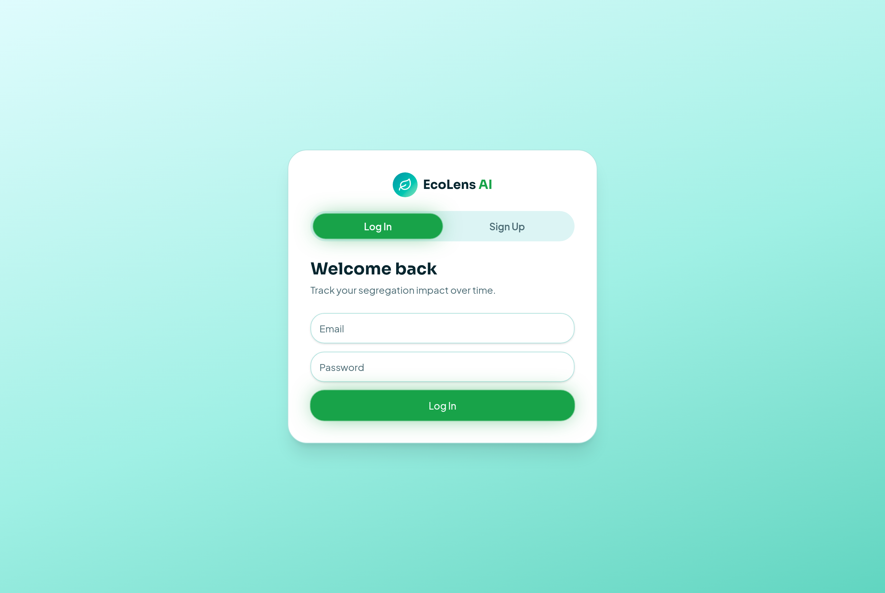
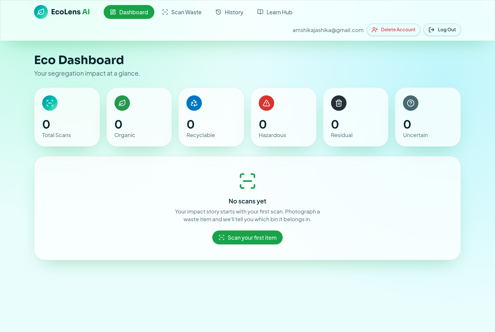
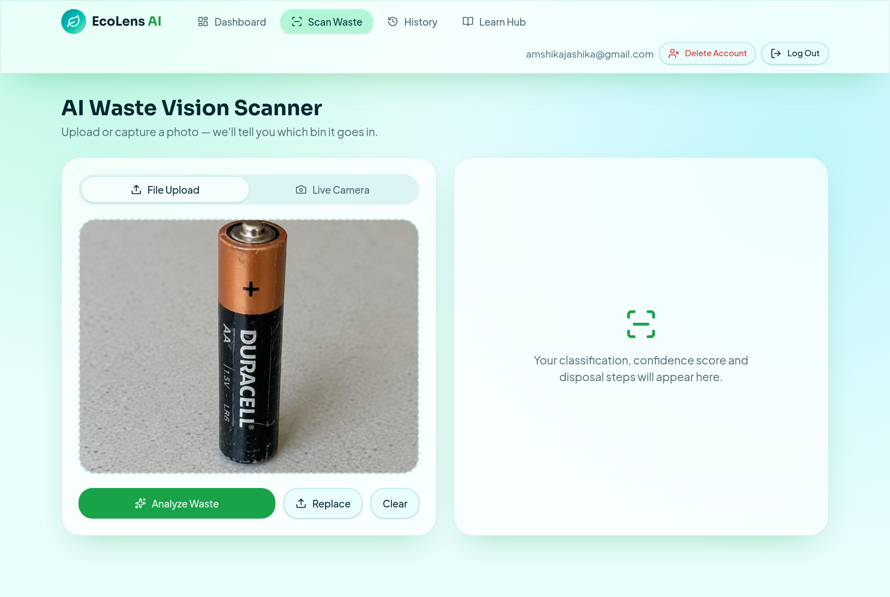
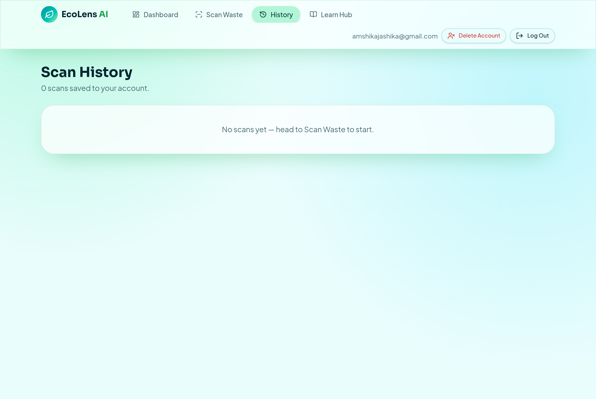
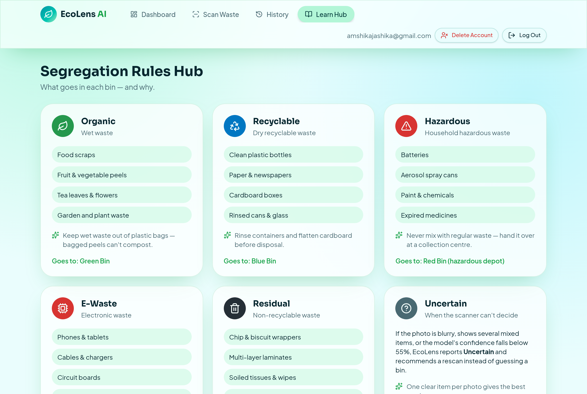
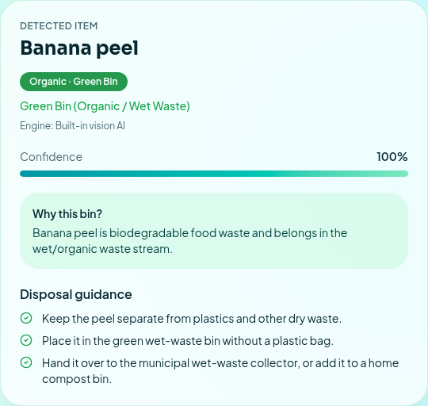
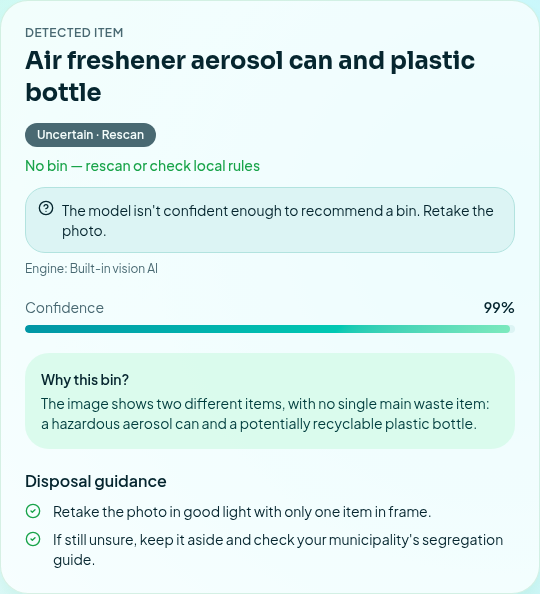

# ECO-LENS-AI — AI-Powered Smart Waste Segregation System

**Scan. Sort. Save.**

**Neural Storm 2026 · Track: Green Planet · Problem Statement GP-05: Smart Waste Segregation System**

| | |
|---|---|
| Team name | solo stack |
| Team leader | Jashika R |
| Institution | Rathinam Technical Campus |
| GitHub | <https://github.com/jashikaraja05-pixel/eco-lens-waste> |
| Live demo | <https://eco-lens-waste.lovable.app> |
| Demo video | [Watch ECO-LENS-AI Demo](https://drive.google.com/file/d/1YGdSYP2cZFC_ar5uKUi2GesWO0AZiHfv/view?usp=sharing) |



## 1. Problem statement

Incorrect waste segregation causes environmental pollution and reduces recycling efficiency. Mixed household waste spoils recycling streams and sends hazardous items such as batteries and e-waste to landfill. Most people don't know which bin an item belongs in, and printed segregation guides are easy to forget.

## 2. Proposed Solution

ECO-LENS-AI is an AI-powered smart waste segregation application that helps users identify and dispose of waste responsibly.

Users can upload an image or capture a photo using their device camera. The AI-powered classification system identifies the waste item, assigns it to an appropriate waste category, recommends the correct disposal bin, and provides useful disposal instructions and safety guidance.

The application supports five main waste categories: Organic, Recyclable, Hazardous, E-Waste, and Residual.

When the prediction is uncertain, the application displays an "Uncertain" result and recommends rescanning instead of presenting an unreliable classification.

ECO-LENS-AI also provides user authentication, private scan history, a personal dashboard, and a Learn Hub to promote responsible waste management.

The project also includes a separately trained 13-class MobileNetV3-Small model that can be integrated through the Python FastAPI backend.

## 3. Objectives

- Make correct segregation a 10-second task for households.
- Never present a guess as a fact: low-confidence results are reported as Uncertain.
- Keep each user's data private.
- Provide a path to a self-hosted, trained model (Python service) without changing the app.

## 4. Key features

- Email/password accounts with email confirmation
- Image upload and live camera capture. The browser accepts JPG/PNG/WebP up to 15 MB and resizes the photo; the server checks type, size and file signature (magic bytes)
- Classification result: category, bin, confidence, explanation, disposal steps, safety notes, reuse tips
- Uncertain state for low-confidence predictions (55% threshold), blurry images or multiple mixed items
- Clear error state with **Try again**; nothing is saved when classification fails
- Private scan history: search, filter, view details, delete one scan, clear all, delete account
- Dashboard computed from saved scans only: totals, per-category counts and chart, active days, average confidence, pilot accuracy (from scans the user marked as checked)
- Learn Hub: five category cards, the Uncertain rule, quick guides (segregation basics, recycling, composting, battery/e-waste safety, plastic reduction, why it matters), and a plain statement of what the scanner can recognise
- Optional Python FastAPI + PyTorch service (`backend/`)

## 5. System Architecture

ECO-LENS-AI uses a web-based architecture with an AI-powered waste classification workflow.

**Currently deployed application:**
- Frontend and application services are hosted through Lovable Cloud.
- Authentication and scan history are managed through the application backend.
- Waste classification currently uses the Lovable AI Gateway vision model.
- The application validates predictions and applies a fixed server-side waste-bin mapping.

**Trained Machine Learning Model:**
- Architecture: MobileNetV3-Small.
- Framework: PyTorch.
- Number of classes: 13.
- Trained model weights and configuration files are available in the GitHub repository.
- Model evaluation results are documented in the Testing section.

**Backend integration status:**

The Python FastAPI service is available in the repository, but it has not yet been deployed and connected to the live application. Therefore, the live website currently uses the Lovable AI Gateway, not the separately trained PyTorch model.

## 6. Technology stack

- **Frontend:** React 19, TanStack Start (SSR + server functions), Tailwind CSS v4, shadcn/ui, lucide-react
- **Backend:** Lovable Cloud (Postgres with row-level security, auth, server functions)
- **AI:** Lovable AI Gateway vision model (`openai/gpt-6-astra`) via the AI SDK
- **Optional service:** Python 3.11+, FastAPI, uvicorn, PyTorch + torchvision (MobileNetV3-Small), scikit-learn
- **Testing:** Vitest (unit), pytest (Python), Playwright (end-to-end)

## 7. AI classification workflow

1. The browser resizes the photo to ≤ 768 px and sends it to the `classifyWaste` server function (sign-in required).
2. The server validates the image (JPEG/PNG/WebP, size limit, file signature check).
3. The selected engine returns `item, category, confidence, reasoning, steps`.
4. `normalizePrediction` (`src/lib/scan-schema.ts`) validates the output, applies the **55 % uncertainty rule**, and sets the bin from a fixed server-side mapping (the model's own bin text is never used).
5. The result is saved to the user's `scans` row and shown in the UI.

Confidence from the built-in vision AI is **self-reported by the model**, so the app labels it "AI-estimated confidence". It is not measured accuracy.

## 8. Categories and Model Coverage

The trained MobileNetV3-Small model supports 13 waste classification classes.

| No. | Trained Model Class |
|---:|---|
| 1 | Battery |
| 2 | Biological |
| 3 | Brown Glass |
| 4 | Cardboard |
| 5 | Clothes |
| 6 | E-Waste |
| 7 | Green Glass |
| 8 | Metal |
| 9 | Paper |
| 10 | Plastic |
| 11 | Shoes |
| 12 | Trash |
| 13 | White Glass |

The application organizes waste into five main categories:

- Organic
- Recyclable
- Hazardous
- E-Waste
- Residual

The trained model provides fine-grained waste classification. The live application's current classification engine remains the Lovable AI Gateway until the Python model service is deployed and integrated.

**Important limitation:** The trained model's 13 classes do not represent comprehensive hazardous-waste detection. It should not be considered a chemical, medicine, or aerosol detection system.

## 9. Dataset Information and Attribution

The MobileNetV3-Small model was trained using a combined dataset consisting of Garbage12 and GIZ E-Waste images.

- The dataset was organized into 13 waste classification classes.
- Training, validation, and testing datasets were separated to evaluate model performance.
- GIZ E-Waste Database is licensed under CC BY 4.0.
- Refer to the original Garbage12 dataset source for its applicable license and attribution requirements.
- Dataset images are not included in this repository. The `backend/data/` directory is excluded through `.gitignore`.

The trained model weights and configuration files are available in `backend/models/`.

## 10. Installation

Follow these steps to set up the ECO-LENS-AI project on your local machine.

### Prerequisites

Make sure the following tools are installed:

- Git
- Bun (JavaScript runtime and package manager)
- Python 3.10 or later
- pip (Python package manager)

### Step 1: Clone the Repository

```bash
git clone https://github.com/jashikaraja05-pixel/eco-lens-waste.git
cd eco-lens-waste
```

### Step 2: Configure Environment Variables

Create the frontend environment file from the example:

**Windows (PowerShell):**
```powershell
Copy-Item .env.example .env
```

**Linux / macOS:**
```bash
cp .env.example .env
```

Add the required configuration values to the `.env` file.

Do not share or commit private API keys, passwords, or secret credentials.

### Step 3: Frontend Setup

Install the frontend dependencies:

```bash
bun install
```

Start the frontend development server:

```bash
bun run dev
```

Open the local development URL shown in the terminal. The default application URL is:

`http://localhost:8080`

### Step 4: Python Backend Setup (Optional)

The Python FastAPI service is available as an optional local backend.

Navigate to the backend directory:

```bash
cd backend
```

Create a Python virtual environment:

```bash
python -m venv .venv
```

Activate the virtual environment.

**Windows (PowerShell):**
```powershell
.venv\Scripts\Activate.ps1
```

**Linux / macOS:**
```bash
source .venv/bin/activate
```

Install the Python dependencies:

```bash
pip install -r requirements.txt
```

### Step 5: Configure Backend Environment

Create the backend environment file.

**Windows (PowerShell):**
```powershell
Copy-Item .env.example .env
```

**Linux / macOS:**
```bash
cp .env.example .env
```

Configure the required backend environment variables, including `CLASSIFIER_API_KEY`, in the backend `.env` file.

### Step 6: Run the Python Backend

Start the FastAPI service:

```bash
uvicorn main:app --reload --port 8000
```

The backend API will be available at:

`http://localhost:8000`

Check the service health endpoint:

`http://localhost:8000/health`

### Step 7: Trained Model Files

The trained model and its configuration files are included in:

```text
backend/models/
```

The directory contains:

- `best.pt` – trained PyTorch model weights
- `config.json` – model configuration
- `evaluation_report.json` – model evaluation results
- `training_summary.json` – training summary

For additional model training and evaluation instructions, refer to the backend documentation.

### Important Deployment Note

The live ECO-LENS-AI application currently uses the Lovable AI Gateway for image classification.

The Python FastAPI backend and trained PyTorch model are available in the repository for local setup and future integration. The Python backend is not currently deployed or connected to the live application.

## 11. Environment variables

| Name | Where | Purpose |
|---|---|---|
| `VITE_SUPABASE_URL`, `VITE_SUPABASE_PUBLISHABLE_KEY`, `VITE_SUPABASE_PROJECT_ID` | web app (public) | Database/auth connection — public values, filled in by Lovable |
| `LOVABLE_API_KEY` | app server (managed) | Built-in AI classification |
| `PYTHON_CLASSIFIER_URL` | app server (optional) | Route scans to the Python service |
| `PYTHON_CLASSIFIER_API_KEY` | app server (optional) | Sent as `X-Classifier-Key` to the Python service |
| `CLASSIFIER_API_KEY` | Python service | Required shared key for `/classify` |
| `ALLOW_UNAUTHENTICATED` | Python service | `1` = skip the key check (local development only) |
| `AI_API_KEY`, `AI_BASE_URL`, `AI_MODEL` | Python service (optional) | Vision-API fallback when no trained model exists |
| `ML_MODEL_DIR` | Python service (optional) | Folder with `best.pt` + `config.json` |
| `CORS_ORIGINS` | Python service (optional) | Comma-separated browser origins; not needed for server-to-server calls |

No secret keys should be committed to the repository. The `.env.example` files contain placeholders for local configuration. Keep actual environment files and private API keys out of version control.

## 12. API endpoints (Python service)

`GET /health` → `{"status":"ok","engine":"local-ml:<dataset>" | "gateway-fallback" | "none","local_model":bool,...}`

`POST /classify` (multipart field `file`, JPEG/PNG/WebP ≤ 6 MB, header `X-Classifier-Key`) →
```json
{"item":"plastic","category":"recyclable","confidence":87,"reasoning":"...","steps":["..."],"bin":"Blue Bin (Dry Recyclable Waste)","warnings":[]}
```
Errors: `401` bad key, `413` too large, `415` not an image, `422` missing file / too small, `503` no engine available, `502` model error, `402/429` usage limits.

## 13. Testing

The project was tested through frontend unit tests, Python backend tests, and end-to-end application testing.

### Application Testing Results

| Test | Result |
|---|---|
| Web unit tests | 16/16 passed |
| Python tests | 16 passed, 3 skipped |
| Plastic bottle classification | Passed |
| User data isolation | Passed |
| Invalid image validation | Passed |
| Oversized image validation | Passed |

The end-to-end test verified user sign-in, image upload, waste classification, and saving the result to scan history.

### Machine Learning Model Evaluation

The MobileNetV3-Small model was evaluated using a separate held-out test dataset.

**Dataset distribution:**
- Training images: 11,387
- Validation images: 2,442
- Test images: 2,438

**Evaluation Results:**

| Metric | Result |
|---|---:|
| Test Accuracy | 96.60% |
| Macro Precision | 95.88% |
| Macro Recall | 95.75% |
| Macro F1 Score | 95.80% |
| Weighted F1 Score | 96.60% |

**Inference Performance:**

| Metric | Result |
|---|---:|
| Mean Inference Time | 10.7 ms |
| P50 Inference Time | 9.0 ms |
| P95 Inference Time | 12.2 ms |

These results represent the separately trained PyTorch model's evaluation performance. They do not represent the measured accuracy of the currently deployed Lovable AI Gateway classifier.

The model was evaluated on 2,438 held-out test images across 13 classes.

## 14. Deployment

- **Web application:** Published using Lovable Cloud. The frontend, authentication, database and AI classification are available through the live application.

  **Live URL:** https://eco-lens-waste.lovable.app

- **Python service (optional):** The Python FastAPI backend is available in the repository but is not currently deployed. A trained local model can be integrated in a future deployment. The currently published application uses the Lovable AI Gateway for classification.

## 15. Limitations and Future Improvements

### Current Limitations

- The live application currently uses a general-purpose vision model through the Lovable AI Gateway.
- The separately trained MobileNetV3-Small model has been evaluated, but its Python FastAPI service is not yet deployed and connected to the live application.
- The model supports 13 waste classification classes and does not provide comprehensive hazardous chemical, medicine, or aerosol detection.
- Classification performance may vary depending on image quality, lighting conditions, and mixed waste items.
- Waste disposal rules and bin colours may differ between municipalities.

### Future Improvements

- Deploy and integrate the trained PyTorch model with the live application.
- Expand hazardous waste classification capabilities.
- Improve model performance using more diverse real-world waste images.
- Add multilingual waste disposal guidance.
- Integrate nearby recycling centres and waste collection locations.
- Improve real-time waste classification and mobile usability.


## For Judges – Application Access

**Application Name:** ECO-LENS-AI

**Live Application:** https://eco-lens-waste.lovable.app

Judges can access the live application using the dedicated evaluation account or create their own account.

### Evaluation Account

A dedicated evaluation account is available for judges to explore the application's existing features and previously saved data.

- The evaluation account contains sample waste classification results.
- Judges can review existing scan history and dashboard statistics.
- Login credentials will be shared separately with the judges for secure access.

### How Judges Can Evaluate ECO-LENS-AI

1. Open the [ECO-LENS-AI Live Application](https://eco-lens-waste.lovable.app).
2. Sign in using the evaluation account credentials shared with the judges.
3. Navigate to the **Waste Scanner**.
4. Upload an image of a waste item or capture an image using the camera.
5. View the AI-generated waste classification result.
6. Check the recommended waste category and disposal bin.
7. Review the disposal instructions and safety guidance.
8. Open **Scan History** to explore previously saved results.
9. Visit the **Dashboard** to view scan statistics.
10. Explore the **Learn Hub** for waste management information.

### Creating a New Account

Judges can also register using their own email address.

1. Open the live application.
2. Select the registration option.
3. Enter an email address and create a password.
4. Complete the email verification process.
5. Sign in and explore the application.

Each account can access only its own scan history.

### Test Case Results

| Test Case | Expected Result | Status |
|---|---|---|
| Plastic bottle image | Recyclable – Blue Bin | Passed |
| Low-confidence prediction | Uncertain – Request rescan | Passed (unit test) |
| Invalid image upload | Reject invalid upload | Passed (unit test) |
| Oversized image upload | Reject oversized upload | Passed (unit test) |
| User data isolation | Users can access only their own scan history | Passed |
| Dashboard statistics | Calculate statistics from saved scans | Passed (unit test) |

### Testing Summary

- **Web unit tests:** 16/16 passed.
- **Python tests:** 16 passed, 3 skipped.
- **End-to-end test:** A plastic bottle image was successfully classified as Recyclable, and the scan was saved to scan history.

## Screenshots

| | |
|---|---|
|  |  |
|  |  |
|  |  |

## AI Tools Disclosure

- Lovable AI coding assistant was used for application development.
- ChatGPT was used for code review, debugging assistance and documentation support.
- The deployed application uses the Lovable AI Gateway vision model for AI-powered waste classification.
- AI-generated images were used for testing purposes.

## License

Released under the [MIT License](LICENSE).
